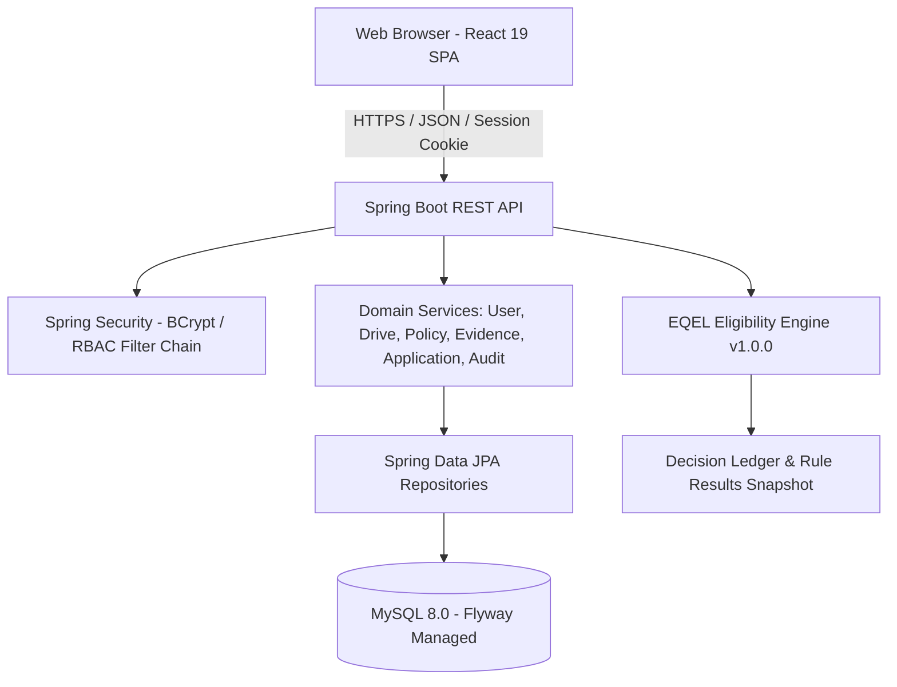

# EQEL — System Architecture Documentation

## 1. Executive Summary
**EQEL (Evidence-Qualified Eligibility Ledger)** is an evidence-aware campus placement eligibility platform. It reconciles student academic records and evidence documents against versioned, company-specific placement policies, recording explainable, immutable, and reproducible eligibility verdicts.

## 2. Core Architecture Principles
1. **Explainability over Black-Box Decisions**: Every rule evaluation details whether it is *Satisfied*, *Violated*, or *Unverifiable*, citing the exact evidence value, threshold, and operational rationale.
2. **Tri-State Eligibility Outcomes**:
   - `ELIGIBLE`: Every admissible scenario satisfies all mandatory placement rules.
   - `INELIGIBLE`: Every admissible scenario violates at least one mandatory placement rule.
   - `UNVERIFIABLE`: Available evidence is insufficient, conflicting, or unverified; an outcome cannot be determined without human verification.
3. **Immutability & Historical Traceability**: Every evaluation references the exact `policy_version_id`, student evidence revisions, decision-engine version (`1.0.0`), and snapshot timestamp. Past verdicts are never overwritten.
4. **Strict Role-Based Separation**:
   - `ADMIN`: User governance, role assignments, audit log review, system health.
   - `PLACEMENT_OFFICER`: Drive management, company profiles, versioned eligibility policies, batch/individual evaluations, evidence verification.
   - `STUDENT`: Profile inspection, evidence submissions, personal eligibility review, drive browsing, application tracking.

## 3. Technology Stack
- **Frontend**: React 19 + TypeScript + Vite, CSS custom properties (tokens), responsive modern design (Instrument Serif / Manrope / JetBrains Mono).
- **Backend**: Java 21, Spring Boot 3.4, Spring Security (form-based cookie sessions, BCrypt hashing, method security), Spring Data JPA, Bean Validation.
- **Database**: MySQL 8.0 with Flyway declarative version-controlled schema migrations.
- **Testing**: JUnit 5, Mockito, Spring Boot Test, Vite/Vitest.

## 4. Component Diagram

## 5. Security & Provenance
- All endpoints enforce server-side authority: `ROLE_ADMIN`, `ROLE_PLACEMENT_OFFICER`, `ROLE_STUDENT`.
- Ownership verification ensures students can never read or mutate other students' records.
- Evidence cannot be self-verified by students.
- Passwords are encrypted with BCrypt (strength 10). No plaintext secrets.
